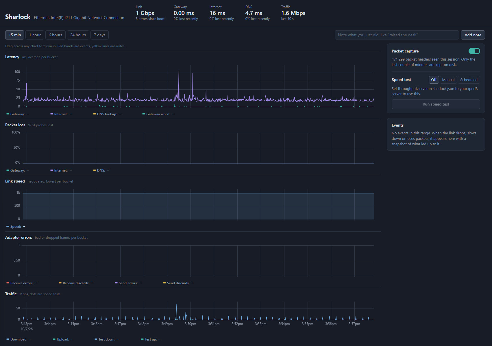
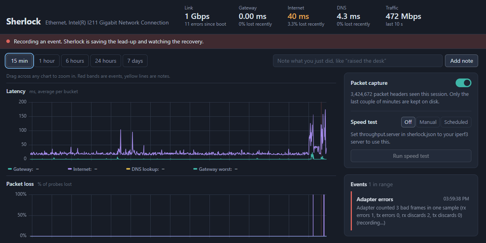
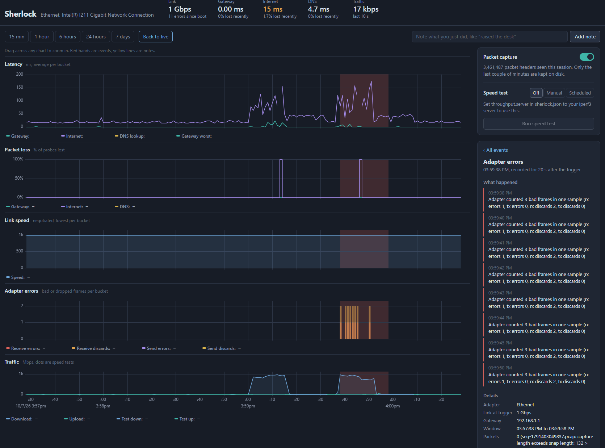

# Sherlock



I was having issues with at the physical layer level. To help diagnose and capture 
metrics to validate theories Sherlock was born.

Sherlock watches on network adapter around the clock and keeps evidence of every
time it misbehaves.

It samples once a second: link state and negotiated speed, the adapter's own
error counters, ping to your router (the segment that includes the physical component being tested),
ping to the internet (to rule your ISP in or out), and DNS. When something goes wrong, it saves
an event folder with the two minutes leading up to it: packet headers, raw samples, and what Windows
itself logged. Everything shows up on a local dashboard with events marked across every chart.




## Requirements

- **Windows 10/11, 64-bit.** Linux works too, mainly for development.
- **Go 1.22 or newer** to build.
- **Npcap** for packet capture: <https://npcap.com>. The default install
  options are fine. Without Npcap, Sherlock still runs and records everything
  except packets.
- **iperf3** (optional) for speed tests. See
  [docs/iperf3-server.md](docs/iperf3-server.md) for the server side.

No administrator rights are needed. Pings use the Windows ICMP helper API and
adapter counters come from the IP Helper API, both available to normal users.

## Build

```powershell
go mod tidy
go build -o sherlock.exe ./cmd/sherlock
```

The Windows build is pure Go (no cgo, no C compiler). You can also build it
from Linux or macOS:

```sh
GOOS=windows GOARCH=amd64 go build -o sherlock.exe ./cmd/sherlock
```

Building for Linux needs cgo and `libpcap-dev` for capture.

To stamp a version: `go build -ldflags "-X main.version=1.0.0" ...`

## First run

```powershell
.\sherlock.exe interfaces     # see adapter names; the default-route one is starred
.\sherlock.exe                # start monitoring
```

The first run writes `sherlock.json` next to the program and opens the
dashboard at <http://127.0.0.1:7878>. With `"interface": ""` it watches the
adapter that carries your default route. Set it explicitly (for example `"Ethernet"`) if
you have several.

Stop it with Ctrl+C. Settings changed in the dashboard (capture on/off,
speed-test mode) are remembered between runs. Everything else is in
`sherlock.json` and takes effect on restart.

Add a note from a second terminal while you work:

```powershell
.\sherlock.exe note "raised the desk"
```

or use the note box on the dashboard. Notes appear as yellow lines on every
chart and are saved inside any event they fall within.

### Reading the evidence

| What you see                                     | What it points to                                                                                                                        |
|--------------------------------------------------|------------------------------------------------------------------------------------------------------------------------------------------|
| Link speed drops from 1 Gbps to 100 Mbps (or 10) | A damaged or poorly seated pair. Gigabit needs all four pairs; 100 Mbps only two, so the NIC falls back. Classic cable or coupler fault. |
| Receive errors climbing                          | Frames arriving corrupted (failed checksums). Physical layer: cable, connector, or interference.                                         |
| Link down events, then back up                   | The connection is physically breaking. Check whether they line up with movement.                                                         |
| Gateway loss with the link still up              | Frames are being lost between you and the router. Usually physical, sometimes the router or switch port.                                 |
| Internet loss but the gateway is fine            | Not your cable. Your ISP or router's uplink.                                                                                             |
| DNS failures alone                               | DNS server or resolver problem, not the physical component.                                                                              |

## What an event folder contains

Events are saved in `sherlock-data/events/<time>_<kind>/`:

| File                                              | Contents                                                                                                                                 |
|---------------------------------------------------|------------------------------------------------------------------------------------------------------------------------------------------|
| `capture.pcap`                                    | Packet headers (first 128 bytes) from the two minutes before through the recovery. Open in Wireshark.                                    |
| `samples-link.csv`                                | Every adapter sample in the window: link state, speed, throughput, errors.                                                               |
| `samples-probes.csv`                              | Every gateway, internet, and DNS probe in the window.                                                                                    |
| `adapter.txt`                                     | Adapter properties, statistics, and advanced settings (speed/duplex config).                                                             |
| `system-events.txt`                               | The Windows System log for the last 10 minutes, collected after recovery so NIC driver "link down" and "link up" entries are both there. |
| `ipconfig.txt`, `routes.txt`, `ip-interfaces.txt` | Network state at the moment of the trigger.                                                                                              |
| `event.json`                                      | Triggers, timing, adapter state at trigger, notes, file list.                                                                            |

Packet capture shows the *effects* of a physical fault (retransmissions, DHCP
and ARP after a link flap, DNS timeouts), not the fault itself: corrupted
frames are discarded by the network card before any capture tool sees them.
They show up in the adapter error counters instead, which is why those are the
primary evidence.

After an event closes there's a cooldown (60 s by default). Triggers during it
are still logged and shown as faint bands, but don't produce a new folder, so
a flapping link creates one snapshot instead of hundreds.

## Resource use

Sherlock runs below normal priority, so games always win the CPU, and the Go
runtime has a 128 MB soft memory limit. In testing it used about 25 MB of RAM
and well under 1% CPU.

- **Capture** writes 15-second segment files and keeps only enough to cover
  the last two minutes. Memory use is a 64 KB write buffer regardless of
  traffic. Speed-test traffic is excluded automatically.
- **Samples** are buffered and written to SQLite every 5 seconds in one
  transaction. Expect roughly 15 MB per day. Samples older than
  `retention_days` (14 by default) are deleted hourly. Event folders and notes
  are kept until you delete them.
- **The dashboard** only does work while it's open in a visible tab.
- **Speed tests** are off by default. In `scheduled` mode they pause while a
  game from `skip_processes` is running or traffic is above `skip_above_mbps`.
  Add the executables of the games you play.

## Configuration

`sherlock.example.json` shows every setting with its default. The ones you're
most likely to change:

| Setting                        | Default             | Notes                                                                             |
|--------------------------------|---------------------|-----------------------------------------------------------------------------------|
| `interface`                    | `""`                | Adapter name from `sherlock interfaces`. Empty = default-route adapter.           |
| `targets.internet`             | `1.1.1.1`           | Control target outside your network.                                              |
| `events.pre_window`            | `2m`                | History saved before a trigger.                                                   |
| `events.post_window`           | `20s`               | Recording after the trigger to capture the recovery. `"0s"` disables.             |
| `events.gateway_latency_ms`    | `50`                | A wired LAN is normally under 2 ms; anything over 50 is a real problem.           |
| `events.interface_error_delta` | `1`                 | Fire on any new error or discard. Raise it if your NIC reports harmless discards. |
| `capture.enabled`              | `true`              | Also toggleable from the dashboard.                                               |
| `capture.filter`               | `""`                | Extra BPF filter, e.g. `"not udp port 3074"` to skip a game's traffic.            |
| `throughput.server`            | `""`                | Your iperf3 server's IP.                                                          |
| `throughput.mode`              | `off`               | `off`, `manual`, or `scheduled`. Also changeable on the dashboard.                |
| `throughput.windows`           | `[]`                | Limit scheduled tests to times like `["01:00-07:00"]`.                            |
| `throughput.skip_processes`    | a few popular games | Executable names that pause scheduled tests.                                      |

Durations are strings like `"900ms"`, `"15s"`, `"2m"`.

## Limitations

- **Windows reports receive errors as one counter.** CRC errors are included
  in it but not broken out (Linux breaks them out). `adapter.txt` in each event
  has whatever extra counters your NIC driver exposes.
- **Link state is polled once a second.** A flap shorter than that can be
  missed by the link chart, but it still tends to show up as errors or pings
  lost, and the driver's own log entry lands in `system-events.txt`.
- **IPv4 only**, and **64-bit Windows only.** The build deliberately refuses to
  compile for 32-bit because Windows' adapter structure differs there.
- **One adapter** per instance.

## Project layout

```
cmd/sherlock/          CLI: run, interfaces, note, version
internal/config/       JSON config and defaults
internal/platform/     OS-specific: adapter counters, ping, gateway, processes, diagnostics
internal/store/        SQLite storage and chart queries
internal/capture/      rolling on-disk packet capture
internal/monitor/      collectors, detector, event recorder, speed tests
internal/web/          dashboard API and embedded front end (uPlot, MIT licensed)
```

Run the tests with `go test ./...`.
